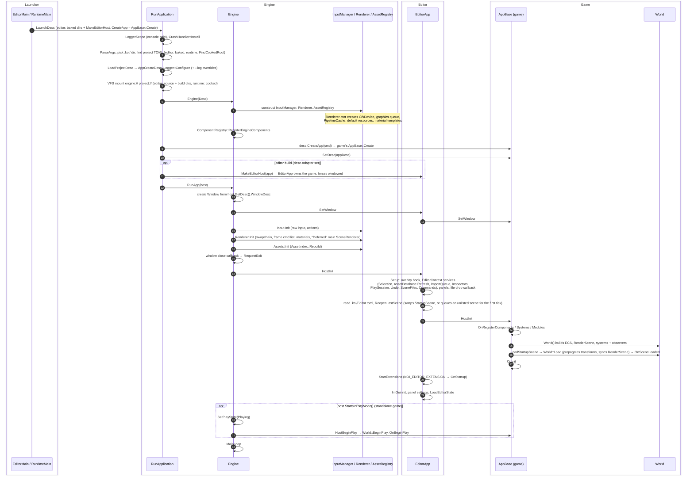
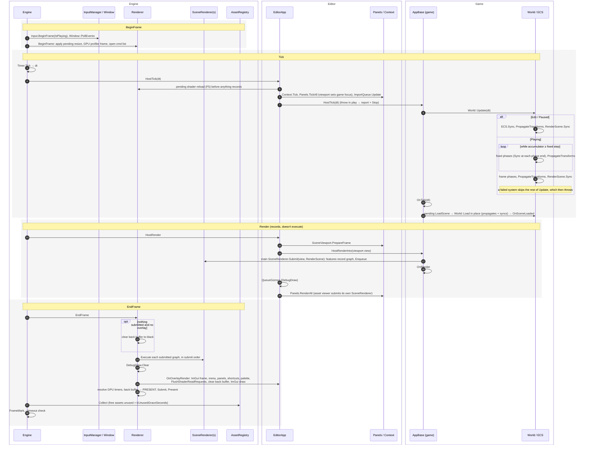
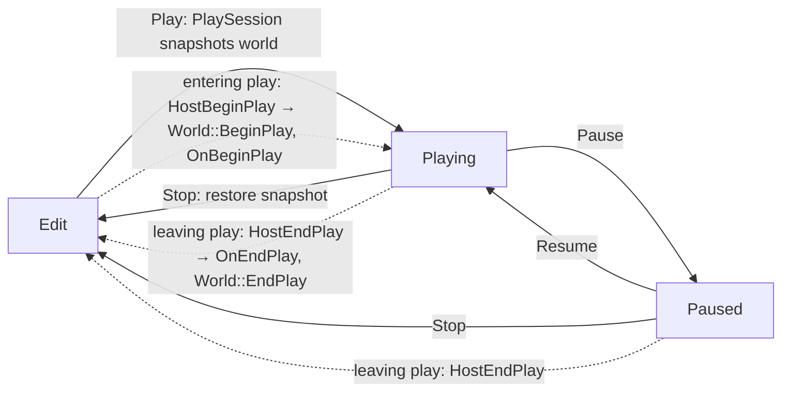
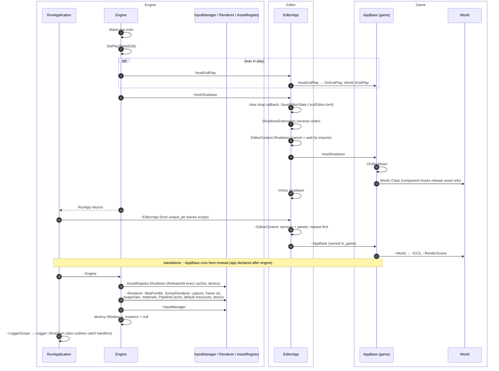

# Lifecycle

How an exe gets from `main` to the main loop, what one frame does, and how it shuts down.
Four layers: **Launcher** (`Launcher/*Main.cpp`), **Engine** (`Koi/Engine`), **Editor** (`Koi/Editor`, `editor-*` modes only)
and **Game** (the project's `AppBase` subclass + its `World`). In `game-*` modes the Editor column doesn't exist and the
Engine calls the game's `AppBase` directly; steps `EditorApp` does itself don't happen.

## 1. Initialization

## 2. Main loop

One iteration of `Engine::MainLoop`, repeated while `m_isRunning`.

Standalone, `HostTick` / `HostRender` go straight to `AppBase`, which renders `GetWindowView()` (the back buffer) and has no overlay.

Play transitions run immediately inside `Engine::SetPlayState`. The editor's play controls call it through `PlaySession`
during `OnOverlayRender`, so `HostBeginPlay` / `HostEndPlay` run inside `Renderer::EndFrame`:

## 3. Shutdown

Starts when `RequestExit` clears `m_isRunning` (window close, File → Exit, `--timeout`, or game code). Teardown is split between
`RunApp`'s tail and scope exit in `RunApplication`; the order matters because the host frees GPU resources in its
destructor, so the device lives until `~Engine`.

Any exception escaping the loop unwinds the same scopes (skipping `HostShutdown`) and is logged with its trace by
`RunApplication`'s catch blocks, which return 1 (std::exception) or 2 (unknown).
